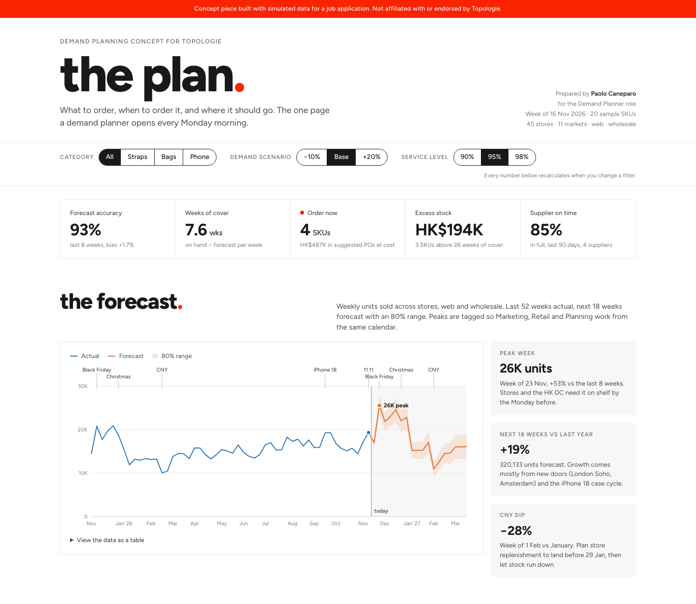

# the plan.

A one-page demand and supply planning concept for **Topologie**, built as part of my application for the Demand Planner role.

**Live page:** _link added after publishing_

## What it shows

| Section | Job responsibility | What you can do |
|---|---|---|
| **the forecast.** | Demand forecasting | 52 weeks of actuals and an 18 week forecast with an 80% range, tagged with 11.11, Black Friday, Christmas, CNY and the iPhone launch. Forecast accuracy and bias are tracked. |
| **the stock.** | Stock planning, inventory management | Every SKU checked against its reorder point, with weeks of cover vs supplier lead time, a suggested PO quantity and an excess stock value. |
| **the supplier.** | Supplier coordination | Open POs with delays and a proposed fix, supplier on-time rate, and a countdown to the Chinese New Year PO cut-off. |
| **the network.** | Cross-functional alignment | Weeks of cover for each market against an 8 to 16 week target, and the inter-company transfers that close the gaps. |

Three filters at the top (category, demand scenario, service level) recalculate every number on the page.

## The method

* **Forecast** = baseline × seasonality × event uplift × trend
* **Accuracy** = 1 − Σ|actual − forecast| ÷ Σ actual (WAPE)
* **Safety stock** = z × σ weekly demand × √lead time (z = 1.28 / 1.65 / 2.05 for 90 / 95 / 98% service)
* **Reorder point** = forecast × lead time + safety stock
* **Suggested order** = (forecast × (lead time + 2 week review) + safety stock) − (on hand + on order), rounded up to the MOQ
* **Excess stock** = units above 26 weeks of cover, valued at cost

## Data

All figures are simulated. Product names and indicative HK$ prices come from topologie.com and authorised retailers, and the store count (45 stores in 11 markets) comes from the Topologie store locator. Supplier names are anonymised. This project is not affiliated with or endorsed by Topologie.

## Run it

One self-contained `index.html` with no build step and no dependencies apart from a Google Font. Open it in any browser, or serve the folder with GitHub Pages.

Built by Paolo Caneparo, November 2026.
